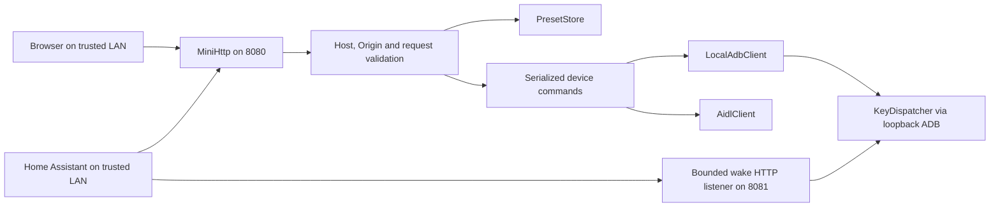

# XGIMI Bridge hardening implementation specification

Status: ready for implementation after this planning task. No application changes are made by this specification.

Target: [Weidav/xgimi-bridge](https://github.com/Weidav/xgimi-bridge), audited at commit `c7f847cd59349d509f315a099c7d9578be8a3959`.

All source paths below are relative to the XGIMI Bridge repository. `/workspaces/windfinder` currently holds the audit and this specification; it is not the application to modify. Implement in a persistent checkout of XGIMI Bridge. Before starting, read that checkout's applicable instructions, compare its target revision with the audited commit and adjust locations for intervening changes.

Evidence:

- [Security assessment](security-reviews/xgimi-bridge/REPORT.md)
- [Assessment of all 105 original entries](security-reviews/xgimi-bridge/CLAIM_REVIEW.md)
- [Saved probes and scanner evidence](security-reviews/xgimi-bridge/evidence/README.md)

This specification supersedes the authentication and transport recommendations in the earlier remediation checklist. The audit remains a record of what was observed.

## 1. Agreed deployment and scope

The owner selected direct HTTP on an isolated, trusted LAN. Every device with network access may control the projector. Implement no API tokens, accounts, passwords, client pairing, credential enrollment, client-IP access list, TLS requirement or reverse-proxy requirement.

The owner allows coordinated updates to the Android server, bundled web UI and Home Assistant integration. The generic answer permitting updated clients and pairing is interpreted in conjunction with the explicit rejection of tokens: client updates are allowed; new client pairing is excluded. Preserve the existing Android ADB authorization flow and key pair because they are used by the bridge to obtain its existing device capabilities.

Network isolation is the chosen access boundary. A reachable LAN client will retain the ability to control, inspect and wake the projector. HTTP traffic remains readable and modifiable by a party able to intercept that network. Document these properties once in deployment documentation; do not add authentication prompts or recurring warnings to normal product flows.

The work addresses malformed requests, bounded resource use, accidental browser-origin access, invalid hardware writes, misleading success responses, preset loss and related lifecycle defects. It also adds regression tests and an orderly release process.

### In scope

- HTTP framing, chunk-size arithmetic, request deadlines and connection limits
- Host/Origin checks that preserve ordinary LAN access
- A bounded, explicit wake request on port 8081, without authentication
- JSON and setting validation on every write path
- Correct write results in the server, web UI and HA integration
- Preset durability, recovery and storage quotas
- ADB key initialization, ambiguous command retries and service shutdown
- HA options-flow repair and delayed-task cleanup
- Build/install correctness, focused dependency triage, tests and documentation

### Excluded

- Authentication, TLS and new client pairing
- Internet exposure, remote-access infrastructure and reverse-proxy deployment support
- A general rewrite of the UI, server or vendor integration
- Refactoring solely to satisfy stylistic entries in `findings_and_flaws.md`
- Changing HDR mappings, wake locks, HDMI cleanup or Binder permissions without device evidence
- Assuming `com.sun.net.httpserver` exists on Android
- Treating development-only Python advisory matches as APK vulnerabilities
- Claims that this work prevents every possible denial of service or proves the application vulnerability-free

## 2. Requirements and traceability

| ID | Required behavior | Audit basis |
| --- | --- | --- |
| R01 | Existing LAN clients can use HTTP without credentials; deployment documentation accurately describes that access | Owner decision; N3 / 1.23 |
| R02 | All request allocations and reads obey explicit byte, count and time limits | N1, N2; 1.27, 3.18 |
| R03 | Ambiguous framing and invalid Host/Origin values are rejected before handlers run | N4; final parser review |
| R04 | Only a valid `POST /wake` request can trigger the wake listener | 1.15; owner retains unauthenticated access |
| R05 | Invalid JSON, types, ranges or routes never reach a device write or storage mutation | N7; 1.10, 1.12, 1.13, 1.25 |
| R06 | Failed or uncertain operations are represented accurately by all three components | N6; 1.11, 1.14, 3.31 |
| R07 | Reading corrupt storage preserves its bytes; failed writes preserve the last valid store | N5; 3.10 |
| R08 | Persistent storage, text injection and pending work have bounded size | N7 and resource review |
| R09 | Concurrent startup and shutdown do not create inconsistent keys or leave managed listeners/tasks running | N7; 1.30, 3.33 |
| R10 | HA setup/options work, and standby remains distinguishable from a confirmed successful action | 1.7; 3.23, 3.26, 3.31 |
| R11 | Build/install scripts handle valid paths and ADB device identifiers without destructive misinterpretation | 1.32, 1.33; installer probe |
| R12 | Automated regressions, device checks and release documentation provide evidence for the fixes | 1.35, 3.39; audit limitations |

## 3. Architecture

Retain the Android app, the shell-UID `KeyDispatcher`, the bundled React application and the HA custom component. Keep ports 8080 and 8081. Keep the loopback ADB connection on 127.0.0.1:5555 and its existing platform authorization.

Responsibilities:

| Component | Responsibility after the change |
| --- | --- |
| `MiniHttp` | Bounded HTTP parsing, socket admission, deadlines, framing validation and cleanup; reusable limits for each listener |
| `HttpServer` | Exact route dispatch, request validation, Host/Origin policy and consistent HTTP responses |
| `RequestPolicy` (small new helper) | Shared authority and Origin validation; contains no client authentication |
| `SettingRules` (small new helper) | Common allowed fields, numeric validation and setting ranges for direct writes and presets |
| `DeviceCommands` (small new helper) | Serializes mutations, applies setting order/pacing and returns explicit results; move hardware application logic out of storage as needed |
| `PresetStore` | Bounded reads, schema validation, initialization/migration and atomic replacement of stored presets |
| `LocalAdbClient` / `KeyDispatcher` | Existing privilege boundary, safe command framing, synchronized initialization and managed wake listener |
| React / HA | Validate server results, present failures and maintain accurate or explicitly pending state |

Keep helpers small. Do not introduce a dependency-injection framework, a general event bus or separate services for every route. Share validation rather than duplicating a different rule set in each write path.

The wake listener should reuse the hardened `MiniHttp` parser with smaller limits. It runs inside the shell helper and exposes only its wake route. Do not maintain a second permissive handwritten HTTP parser.

## 4. HTTP limits and request policy

### 4.1 Initial limits

These are implementation defaults to cover with boundary tests. Change them only with measured compatibility evidence.

| Limit | Port 8080 | Port 8081 |
| --- | --- | --- |
| Request-line length | 4,096 bytes | 512 bytes |
| Individual header line | 4,096 bytes | 1,024 bytes |
| Aggregate request line and headers | 16,384 bytes | 4,096 bytes |
| Header count | 64 | 16 |
| Decoded body | 65,536 bytes | 0 bytes |
| Chunk-size line | 128 bytes | Chunked requests rejected |
| Trailer bytes / count | 4,096 bytes / 16 fields | No trailers |
| Header-read deadline | 5 seconds | 1 second |
| Complete request-read deadline | 10 seconds | 1 second |
| Response-write deadline, starting with the first response byte | 5 seconds | 1 second |
| Idle keep-alive | 2 seconds | Close after response |
| Requests per connection | 100 | 1 |
| Active connection/worker ceiling | 64 total, 8 per peer address | 8 total, 2 per peer address |

The per-peer limit is resource admission control; it must not become a configured list of allowed clients. Derive the peer from the accepted socket, never a forwarded header. Reject overload promptly with 503 where a bounded response is possible; otherwise close the socket. Do not block the accept thread while writing an overload response to a peer that will not read.

Keep the existing bounded executor model initially. Do not add an unbounded queue. A client may still occupy its allocation temporarily; the requirement is bounded occupancy, timely expiry and recovery. Distributed traffic can still exhaust finite resources.

### 4.2 Parser implementation rules

1. Validate each chunk length against `MAX_BODY_BYTES - totalBytes` before addition and before allocation. Keep the cumulative count within the valid range at every step.
2. Enforce the limit on the sum of all decoded chunks, not merely individual chunks. Preserve rejection of oversized fixed-length bodies.
3. Use a monotonic clock. Track absolute deadlines for the header phase and complete request input. Check them in all loops, including buffered reads, chunk sizes, data, delimiters and trailers.
4. Set each blocking read timeout to the remaining deadline. Sending a byte periodically must not renew the overall deadline.
5. Bound headers and trailers by count and bytes. Reject truncated lines, incomplete chunk endings and premature EOF. A failed parse must never dispatch a request.
6. Reject duplicate Host, Origin, Content-Length and Transfer-Encoding fields before collapsing headers into a map. Reject a request containing both Transfer-Encoding and Content-Length. Reject unsupported transfer codings.
7. Require decimal nonnegative Content-Length and hexadecimal nonnegative chunk lengths. Reject signs, overflow and invalid separators. Accept supported chunk extensions only within the existing size-line bound; do not give them semantics.
8. Require exactly one valid Host for supported requests. Use strict CRLF framing for this appliance's supported clients. Reject obsolete folding, control characters in header names/values and malformed request targets. Keep normal GET, HEAD, POST, PUT and DELETE behavior.
9. Support origin-form targets. Reject absolute-form targets instead of silently stripping their authority; this deployment does not use the projector as an HTTP proxy.
10. Include `Connection: close` on framing, deadline and overload errors. Maintain correct HEAD responses and content lengths. Send `Allow` with 405 responses.
11. Add bounded response-write handling as well as input deadlines. `Socket.setSoTimeout` does not limit writes. A small shared watchdog may close an expired connection; disarm it before reusing a connection and stop it during shutdown. Do not create one timer thread per request.

Parser policy is deliberately stricter than the complete range of legal HTTP behavior where first-party clients do not need that complexity. [RFC 9112](https://www.rfc-editor.org/rfc/rfc9112.html#section-6.3) is the reference for message framing and length handling.

### 4.3 Host and Origin behavior

Keep all LAN clients authorized by network reachability. Separately validate which server address a request names:

- Accept the projector's current interface IP addresses with the actual listener port; normalize IPv4 and bracketed IPv6 literals without DNS lookups.
- Permit `localhost` for loopback connections. Permit additional exact DNS aliases only when configured locally on the projector. Do not learn an alias from an incoming request or trust it merely because it resolves to a device address.
- Store optional aliases in app-private configuration and expose an optional local setting in `LauncherActivity`. Ordinary access by projector IP requires no extra setup. Bound the list to 16 exact ASCII DNS names, normalize case and a trailing dot, and reject wildcards, schemes, paths and invalid labels. Pass the validated alias configuration to the shell helper through its existing bounded stdin channel, not shell-string interpolation.
- Reject an unapproved Host even when Origin contains the same attacker-selected hostname. Apply the Host check to assets as well as API routes.
- For mutations, accept absent Origin for HA and other native LAN clients. If present, require a syntactically valid HTTP origin on an allowed device authority. Reject `null`, userinfo, malformed ports, paths and arbitrary domains. Do not enable wildcard CORS.
- The wake endpoint may accept the approved UI origin on port 8080 in addition to its own authority; native HA requests normally have no Origin.

This policy limits browser-origin abuse and rebinding opportunities. It does not authenticate clients or protect against a malicious client already on the isolated network.

### 4.4 Wake endpoint

Replace wake-on-TCP-accept with `POST /wake`, an empty body and the shared request policy. A connect-and-close, GET, malformed request or unknown route must not inject a wake event. Return 405 for other methods on `/wake`, 404 for other paths and a normal result after a valid wake request is accepted by the injector.

Keep HA's existing preliminary knocks to ports 8010 and 6465 until real standby testing establishes they are unnecessary. Test the new listener while the projector is suspended. Do not silently restore wake-on-connect if a test fails; diagnose the CPU wake sequence separately from display wake.

## 5. Input validation and API behavior

### 5.1 JSON and routes

Require a complete JSON object for endpoints with structured bodies. Reject invalid UTF-8, parse failures, incomplete documents and trailing non-whitespace content. Bound object/array nesting at 16 before invoking a recursive JSON parser; the preflight must understand quoted strings and escapes. Retain Android's JSON implementation unless a demonstrated requirement warrants an additional runtime dependency.

An empty body is valid only where documented, such as power actions or applying an existing preset. Preset creation requires a valid object. Malformed input must never become an empty object or create an Untitled preset. Do not log complete malformed bodies or injected text; log a bounded error code, route and byte count.

Dispatch exact paths and segment counts. `/api/input-extra`, `/api/presets-other` and extra path suffixes must not alias valid mutation routes. Preset IDs remain logical identifiers and never become filesystem paths.

Validate the entire operation before the first hardware or storage side effect. Unknown writable-setting names produce a validation error. Telemetry-only fields must not accidentally become writable settings.

### 5.2 Setting schema

Use the existing first-party controls as the initial supported write surface. These sets do not claim to enumerate every capability of every firmware.

| Field / endpoint | Accepted values |
| --- | --- |
| `wbRed`, `wbGreen`, `wbBlue`; `wb-red`, `wb-green`, `wb-blue` | Integers 0–100 |
| `brightness`, `contrast`, `saturation`, `sharpness`, `hue` | Integers 0–100 |
| `pictureMode` / `picture-mode` | 1, 3, 4, 6, 9 |
| `colorTemp` / `color-temp` | 0, 1, 2, 3, 4 |
| `gameMode` / `game-mode` | 0, 1, 2 |
| Reset `mode` | 0 for the existing default, or a supported picture-mode value |
| Reset `force` | Boolean; omitted means false |
| Input `to` | Existing supported names: STORAGE, HOME, APPS, HDMI1, HDMI2, HDMI3, normalized consistently |
| Key-event route parameter | Integer between 0 and Android's maximum defined key code; reject negative/out-of-range values |
| Text | Nonempty string, at most 1,024 Unicode code points and 4,096 UTF-8 bytes; reject NUL and invalid Unicode |

Accept JSON numeric values only when finite, mathematically integral and in the allowed range. Strings, booleans, null, fractional values and overflowing numbers are invalid; never coerce them through a sentinel such as `Integer.MIN_VALUE`. An integral numeric representation such as `50.0` may normalize to 50. Do not use truthiness to reject zero.

Apply identical rules to direct setting writes, preset create/update/sync and values loaded for preset application. Unsupported stored values cause an explicit error before application; preserve the original file for correction. Do not silently clamp values or rewrite them on read.

The updated web client must send only writable fields when saving/syncing a preset. The current implementation sends the whole picture snapshot; update it before enforcing strict writable-field input. Omitted values may request an explicit capture operation as documented; an explicitly supplied empty values object is rejected instead of silently changing meaning. For partial presets, omit unchanged fields; explicit null is invalid.

### 5.3 Status and error representation

Retain existing successful read and preset object/array shapes to limit client churn. Use one consistent error object with `ok:false`, a stable `code` and a short `error` message; add structured details only when callers can act on them. Do not return stack traces or vendor exception strings to clients.

| Situation | HTTP status | Example code |
| --- | --- | --- |
| Invalid JSON, type, range, identifier or framing | 400 | `invalid_request` |
| Disallowed Host/Origin or protected built-in edit | 403 | `request_forbidden` / `builtin_read_only` |
| Missing route or preset | 404 | `not_found` |
| Wrong method | 405, with Allow | `method_not_allowed` |
| Request-read deadline exceeded | 408, then close | `request_timeout` |
| Oversized body/name/text or storage quota | 413 | `limit_exceeded` |
| Nonempty JSON endpoint body with incompatible content type | 415 | `unsupported_media_type` |
| Hardware setter false or reliable verification failure | 502 | `device_write_failed` |
| Busy admission limit or device service unavailable | 503 | `busy` / `device_unavailable` |
| Bounded device operation times out | 504 | `device_timeout` |
| Corrupt/unreadable store or unexpected internal failure | 500 | `preset_store_unavailable` / `internal_error` |

Add the needed statuses to MiniHttp rather than substituting success statuses. Accept `application/json` with an optional UTF-8 charset. Bodyless commands do not require a content type. Client updates may be required for this stricter behavior.

### 5.4 Hardware results, ordering and retries

Use one shared mutation coordinator for direct writes, preset application, reset and power actions. Bound lock acquisition at 250 ms and return 503 when another mutation occupies it; do not accumulate an unbounded command queue. Use a separate short storage lock and avoid holding it during hardware calls. Capture or copy data in a defined order so no path acquires the storage lock and then waits for the device lock while another path does the reverse.

Validate all preset values first. Preserve the existing mode-before-white-balance order and required pacing. Stop on the first failed setting, return failure with the applied fields and failed field, and refresh the state. Do not claim rollback: preceding hardware changes may already have taken effect.

For getters known to be reliable, success requires setter acceptance and bounded readback convergence. For the picture-item getters already documented as unreliable, report setter acceptance without claiming verified readback. Never add retries based on known-bad readback. Reset must aggregate the actual results and omit an irrelevant sentinel `value` from its response.

Use Android's dedicated wake/sleep events for idempotent on/off where device testing confirms support. Keep explicit toggle as a distinct action. If the firmware cannot support the dedicated action, use a serialized state transition with a bounded confirmation period; concurrent on/on or off/off requests must not issue opposing toggles while the first transition is pending.

Separate command acceptance from observed power state. A command can return 202 with `accepted:true` and `pending:true` when execution was accepted but transition is not yet observed. It must not return an invented `awake` value. Clients should refresh and show pending state until observation succeeds or expires.

Do not automatically resend text, key events, toggle or restart after a transport error when bytes may already have been delivered. Report an uncertain result and resynchronize. Reconnection before any command was delivered is safe; bounded retries of idempotent setting writes remain possible. A client-side timeout does not prove that a device action was cancelled. Bound scheduled work between operations and document that an in-progress vendor Binder call may not be interruptible.

## 6. Preset durability and quotas

Keep the current JSON-array storage format and existing IDs where valid. Introduce a typed distinction between missing, valid, corrupt, unreadable and oversized stores. A corrupt, unreadable or oversized existing file must never be treated as an empty/new store.

- Initialize defaults only when no store exists, during explicit service/store initialization. Check the storage primitive's recovery files before declaring a store absent.
- Make ordinary GET/HEAD loads read-only. Perform any required built-in migration explicitly at startup, after successful validation and with preservation of the original bytes.
- Use Android `AtomicFile` for replacement writes: complete the write, finish it on success and roll it back on failure. Keep external synchronization because AtomicFile does not provide thread synchronization. Remove the fallback that truncates and overwrites the live file after rename failure. See the [Android AtomicFile API](https://developer.android.com/reference/android/util/AtomicFile).
- Preserve a recovery copy before an actual schema/built-in migration. Never overwrite an existing recovery copy automatically; include recovery instructions. Do not generate a new backup on every normal read.
- If a store is corrupt, return an explicit storage error and preserve it. Unrelated device control remains available. Resetting or replacing the store requires an explicit local maintenance action.
- Reject built-in value changes, sync, rename and deletion consistently with 403. Show that read-only status in the clients instead of accepting edits and later reverting them.

Initial quotas:

| Resource | Limit |
| --- | --- |
| Custom presets | 100, excluding built-ins |
| Preset name | 1–80 Unicode code points and at most 320 UTF-8 bytes after trimming |
| Newly generated ID | At most 96 ASCII characters, preserving uniqueness after truncation |
| Live serialized store | 262,144 bytes |
| Existing-store read | Stop at the same limit before allocating/parsing the whole file |

Check count and serialized-size limits inside the same storage lock as the commit. Check creates and updates. Existing stores exceeding new limits are preserved and reported for explicit export/reduction; never discard records to make them fit. Preserve old IDs in valid stores, even if the new ID generation rule is shorter.

## 7. ADB initialization and lifecycle

Every call to `ensureKey()` must use the same `keyLock`, including the path through `ensureDispatcher()`. Define the lock order as dispatcher lock followed by key lock where both are necessary; key-locked paths must release it before acquiring the dispatcher lock. Protect the fields consistently rather than relying on an unsynchronized fast path.

Read/generate both keys into local variables, validate that they form a pair, complete persistence, then publish the pair. Handle an incomplete legacy pair explicitly. Use a recoverable commit sequence or one atomic key record so an interrupted generation does not silently leave mismatched files. Preserve existing valid keys; do not force reauthorization on every upgrade. Exclude ADB private key material from unintended Android backup/transfer paths and never log it.

Manage the shell wake server as part of the helper lifetime. Close it in a `finally` path when stdin closes or the helper exits. A malformed bootstrap/configuration line must be rejected without expanding accepted hosts. Limit configuration input and retain integer/Base64 framing for existing commands.

On service stop, reject new work, close accepted sockets, cancel watchdogs and queued callbacks, and wait a bounded period for handlers before disconnecting shared clients. Cooperative waits must observe interruption. Do not pretend thread interruption can abort every Binder call.

Recover from listener bind failure with a single bounded backoff schedule, for example 1, 2, 4, 8, 16 and then 30 seconds between attempts. Cancel it on service destruction. Clean up partially started listener resources before retrying; do not create duplicate ADB warm-up loops or indefinitely accumulate objects. Keep existing wake/Wi-Fi lock behavior until measured device evidence supports a change.

## 8. Client changes

### Web application

Extract the transport wrapper into a small independently testable module if needed. A non-2xx status, a malformed expected JSON response or `ok:false` must raise a useful error. Existing successful read responses without an `ok` property remain valid. Handle 202/pending separately from completion.

Update direct setters, input switching, reset, preset save/sync/apply/delete and power actions to use the same outcome rules. Apply optimistic updates only after accepted success and only where readback is intentionally unreliable. On partial preset failure, reconcile observed state and show the error instead of applying all requested values locally.

Serialize/coalesce slider writes so a busy response does not discard the user's final slider position or queue stale values. Do not retry non-idempotent commands blindly. Preserve the existing cancellation/circuit-breaker behavior around offline transitions.

HTTP LAN origins cannot rely on Clipboard API availability. Keep raw diagnostic output selectable and expose a clear manual-copy fallback when automatic copying is unavailable. Remove silent success/failure for that action. This is a compatibility fix for the selected HTTP deployment, not a reason to add TLS.

### Home Assistant

Fix both parts of the options-flow error: instantiate `XgimiOptionsFlowHandler()` without a config-entry argument, and remove assignment to the framework-managed `self.config_entry`. Use HA's property. [Official migration guidance](https://contributors.home-assistant.io/blog/2024/11/12/options-flow/) documents this pattern.

Centralize command-response parsing in the coordinator. Detect non-2xx, invalid responses and HTTP 200/`ok:false`. Surface a `HomeAssistantError` from failed entity actions. Do not leave button, switch, number or select methods silently ignoring a false result. Preserve successful existing read shapes and use HA's shared aiohttp session.

Apply the same checks to the dedicated wake, fallback power-on and power-off paths; changing only `async_post_json()` is insufficient. A failed wake attempt must not set both `awake` and `online` to true. A dropped connection while entering standby is an uncertain outcome until refreshed, not automatic proof of either success or failure.

Retain the ability to initiate wake when the projector is in standby. Keep HA's existing refresh debouncer. Track delayed refresh handles/tasks and cancel them on unload or replacement. Ensure an unloaded coordinator cannot later publish data or send a device command.

Validate a configured host as a hostname or IP literal, without a scheme, path or userinfo. Construct URLs with proper IPv6 authority handling. Preserve existing entry/entity identifiers. Keep setup possible while the projector is legitimately asleep; a three-second connection failure alone cannot establish invalid configuration. No credential fields are added.

## 9. Ordered implementation steps

Each step is a reviewable change with its own focused validation. Do not mix unrelated stylistic cleanup or bulk dependency upgrades into these changes.

### Step 1 — Establish regression tests

Files: new test directories under the target repository; the audit evidence is input, not a production dependency.

- Add a repeatable JVM harness that compiles the real MiniHttp, HttpServer, PresetStore and new pure helpers, with explicit Android/device stubs where necessary. Pin and document any test-only JSON/runtime dependency.
- Convert the saved probes into tests of desired behavior. The original audit scripts deliberately expect vulnerable behavior and are not suitable unchanged.
- Add frontend tests around the extracted transport module and HA tests around coordinator responses and the options-flow factory. Use the smallest test setup that can exercise those behaviors.
- Keep device calls stubbed for parser/input tests. Record zero hardware calls and zero storage writes on rejected input.

Completion: the relevant regression fails against the audited behavior and is reproducible without a projector. Do not require unrelated existing failures to be hidden or suppressed.

### Step 2 — Repair HTTP framing and resource handling

Files: `MiniHttp.java`, parser/connection tests.

Implement section 4.1 and 4.2, including safe cumulative arithmetic, count limits, total deadlines, write expiry, admission accounting and cleanup on every exit path. Add status values and controlled errors. Keep the accept loop responsive.

Completion: overflow, slow-input, framing, overload and recovery tests pass; ordinary requests, HEAD and supported keep-alive behavior still work.

### Step 3 — Apply browser request policy and bounded wake handling

Files: `RequestPolicy.java`, `HttpServer.java`, `KeyDispatcher.java`, `LocalAdbClient.java`, `LauncherActivity.java` and local alias configuration storage.

Implement canonical Host/Origin validation and reuse the hardened parser for the wake listener. Supply the same locally configured aliases to both processes. Preserve the existing HA CPU-wake knocks. Add no authentication.

Completion: ordinary LAN browser/HA access needs no token; an arbitrary matching Host/Origin is rejected; a bare TCP connection cannot turn on the display; valid POST wake works in the local harness.

### Step 4 — Validate commands and make outcomes accurate

Files: `SettingRules.java`, `DeviceCommands.java`, `HttpServer.java`, `PresetStore.java`, targeted ADB command handling.

Implement complete-body validation, exact routes, shared ranges, size limits, serialized writes and the response rules. Move only the hardware-application logic needed to share ordering/result handling. Prevent ambiguous automatic replay of non-idempotent commands.

Completion: invalid inputs cause no side effects; setter false, non-convergence, partial application and uncertain power transitions produce the specified response.

### Step 5 — Make preset storage recoverable

Files: `PresetStore.java`, storage tests and recovery documentation.

Implement explicit initialization/migration, read-only loads, AtomicFile replacement, quotas and built-in protection. Validate stored values before applying them. Preserve corrupt/oversized data and failed-write recovery paths.

Completion: unchanged reads preserve file bytes/mtime; corrupt reads preserve original bytes; fault-injected saves preserve the prior valid store; quota checks hold under concurrency.

### Step 6 — Update web and HA clients together

Files: `web/src/App.jsx`, a small transport module if introduced, relevant CSS, HA coordinator/config-flow/entity modules and tests.

Implement section 8. Narrow preset payloads to writable fields. Handle busy, partial and pending outcomes. Repair the HA options factory/constructor and cleanup callbacks. Keep all setup and requests credential-free.

Completion: both clients show failed writes, preserve the final requested slider value, avoid false power success and can perform existing normal controls against the hardened server.

### Step 7 — Finish initialization, shutdown and tooling fixes

Files: `LocalAdbClient.java`, `KeyDispatcher.java`, `BridgeService.java`, manifest/backup resources, `app/build.sh`, `app/install.sh`.

- Complete the key locking/persistence and lifecycle changes in section 7.
- Quote build paths and use arrays or argument files for Java/class inputs. Check that the output directory is the intended build directory before removing it. Keep Android bootclasspath compilation; do not substitute Java SE APIs using a blind `--release` change.
- Track whether an installer target came from `adb devices` or explicit host input. Preserve auto-detected USB/emulator/TCP serials exactly. Append a default port only to a validated explicit host lacking one. Handle IPv6 unambiguously or fail with a clear syntax message.
- Check required SDK tools, the input APK and device selection before performing installation steps. Verify the generated APK signature, while retaining the existing signing identity needed to upgrade an installed app.

Completion: concurrent key initialization yields one pair; repeated start/stop releases resources; mock-adb tests cover USB, emulator, explicit hostname/IP and ambiguous device selection; a path containing spaces builds correctly.

### Step 8 — Dependency triage, documentation and release validation

Files: README, corrected findings document, test commands/CI and separately scoped dependency changes.

- Re-run web and Python dependency checks at implementation time. Evaluate the active Python marker branch, rather than counting every version in `uv.lock` as installed.
- Update affected development dependencies through the target repository's dependency workflow in separate changes. Preserve the distinction between HA's installed runtime and this repository's development lockfile. Do not independently pin HA-provided aiohttp in the integration manifest without a real requirement.
- Pin externally downloaded development installers to a reviewed version and verify their digest before execution. Pin new CI actions to reviewed immutable revisions and keep these tooling changes separate from application fixes.
- Document deterministic setup, test commands, the selected LAN model, new request limits, error semantics, preset recovery and upgrade procedure.
- Correct or retire the disproved original findings. Mark accepted unauthenticated access as the owner's deployment decision, not an implemented authentication fix.
- Run the automated matrix and controlled device checks below before declaring the release ready.

## 10. Test matrix

Tests must execute production code paths. Stubs are appropriate for hardware collaborators, but cannot establish Android firmware behavior or the correctness of a platform storage primitive.

| Area | Required cases | Evidence required |
| --- | --- | --- |
| Body arithmetic | Empty, exactly 65,536 bytes, one byte over, excessive single chunk, cumulative overflow, invalid/negative sizes | Controlled acceptance/rejection; no OOM; rejected handler never runs |
| Framing | Duplicate/conflicting length, TE+CL, duplicate Host/Origin, malformed delimiters, truncated chunks, oversized trailers | Error and closed connection before dispatch |
| Deadlines | Slow request line, headers, fixed body, chunk data, trailers and response consumer | Expiry within configured deadline plus at most one second scheduling allowance in the harness |
| Capacity | Per-peer and global limits, disconnects, exceptions, stop/restart | Bounded threads/sockets; counters return to baseline; another peer works while a peer is limited; ordinary service recovers |
| Browser policy | Real device IP, configured alias, IPv6 literal, arbitrary Host, matching arbitrary Origin, null/malformed Origin | Expected allow/deny without token requirements |
| Wake | Bare connect, GET, wrong path, malformed/slow request, valid POST | Zero injected events for rejected traffic; one accepted wake event for a valid request |
| Validation | Invalid UTF-8/JSON, trailing data, deep nesting, strings/booleans/null/fractions/overflow, zero, enum boundaries, oversized text | No side effects on rejection; identical setting rules for all paths |
| Results | False setter, failed readback, unreliable getter, partial preset, busy mutation, lost acknowledgment | Accurate status/body; no unjustified replay or false completion |
| Storage | Missing/corrupt/unreadable/oversized file, failed write/finish, built-in edit, count/byte boundary, concurrent create | Preserved prior bytes or correct atomic commit; no silent reset or quota bypass |
| Web | HTTP errors, 200/`ok:false`, malformed response, 202 pending, partial failure, final slider value, HTTP clipboard fallback | Visible errors and correct state transitions |
| HA | Both options-flow construction paths, entity command failure, wake/fallback/off outcomes, standby setup, unload timers | Useful HA error/state behavior and no callbacks after unload |
| Tooling | Spaces in paths, missing SDK/APK, USB/emulator/TCP targets, multiple devices | Deterministic safe arguments; no real device action in unit tests |

Use the 64 MB JVM harness for the overflow regression, with a bounded input. Run network tests only against loopback/local test instances. Do not use a production projector for saturation or memory-exhaustion tests.

Storage fault tests must cover the adapter's real write/replace behavior. Add an Android emulator/device check for AtomicFile integration; an audit stub returning success is insufficient. Verify JSON behavior with an Android-compatible implementation and the APK build.

Run the options-flow regression against both HA 2026.2.3 and 2026.10.2, the versions involved in the audit, using compatible isolated Python environments. If implementation deliberately drops an old HA version, declare the supported minimum and test it plus the current version; do not silently claim an untested version range.

### Device acceptance checks

Record projector model, firmware and Android version with results:

1. Upgrade the existing APK without deleting presets or replacing a valid ADB key.
2. Open the UI by IP and any configured LAN alias; use HA without new credentials.
3. Exercise direct setters, reset, presets, input switching, keys and text with valid values.
4. Run on/on and off/off concurrently and confirm no double toggle; test explicit toggle separately.
5. Test wake after actual standby and after reboot, including HA's preliminary knock sequence.
6. Confirm repeated service start/stop and listener failure recovery leave one working helper/listener.
7. Verify backup exclusions and a failed storage replacement on an emulator/test installation.
8. Record whether dedicated sleep/wake keys and setting readbacks behave as assumed; resolve failures before release rather than changing vendor enums speculatively.

## 11. Rollout and rollback

1. Preserve the current signed APK, matching HA component, preset export and app data recovery instructions. Avoid exporting ADB private keys into reports or logs.
2. Release compatible web and HA error handling/payload changes first when practical. The updated clients must still detect legacy HTTP 200/`ok:false`; they cannot repair a legacy server that falsely returns `ok:true`.
3. Build the hardened APK with its matching web bundle. Install it with the existing signing identity and version metadata appropriate for an upgrade. Do not uninstall merely to bypass a signature mismatch.
4. Load valid existing data through the explicit migration path. A migration failure must preserve data and show a recoverable error; it must not enable a hidden permissive mode or silently reset presets.
5. Use the updated HA integration and refresh the cached web shell. If a controller uses a DNS alias, configure that alias locally; direct access by IP remains available. Version or revalidate the HTML shell so a one-day cache does not strand the user on stale client behavior.
6. Run the device acceptance checks and retain logs without sensitive payloads.
7. If rollback is required, restore the prior APK/HA combination and only restore preset data from a known backup after checking format compatibility. Document any additional state created by the new storage implementation. Rollback retains the same isolated-LAN deployment assumption.

No pairing, token distribution or authentication migration is part of this rollout.

## 12. Completion criteria

Implementation is complete when all of the following are true:

- R01–R12 have passing automated or documented device evidence, with unsupported firmware behavior explicitly resolved or removed from the supported surface.
- The overflow input cannot cause an oversized allocation, and every request phase has a working total deadline and size/count limit.
- The reproduced slow-client case expires and normal requests recover; resource counters and threads return to their configured bounds.
- Invalid requests and bare wake connections produce no device/storage side effects.
- Valid browser and HA clients retain credential-free access on the isolated LAN.
- Both clients surface failed writes and distinguish accepted/pending power actions from observed state.
- Corrupt presets remain recoverable; failed writes do not truncate the last valid store; quotas cannot be bypassed by concurrent writes.
- Options flow, key initialization, lifecycle cleanup and installer target selection pass their regressions.
- The APK builds for the existing Android 14 target, the web production build succeeds, and HA checks pass for the declared supported versions.
- Active dependency findings have been reviewed with explicit applicability and a fix or documented disposition in their separate change.
- README and the findings list match the implemented behavior and the owner's accepted network-access model.
- The final implementation report lists actual checks, any remaining limitations and the revisions tested. It does not claim firmware coverage based only on JVM stubs.

This document is ready to guide implementation. The current task changes only this specification; it does not authorize an automatic deployment or claim that any application fix has already been made.
